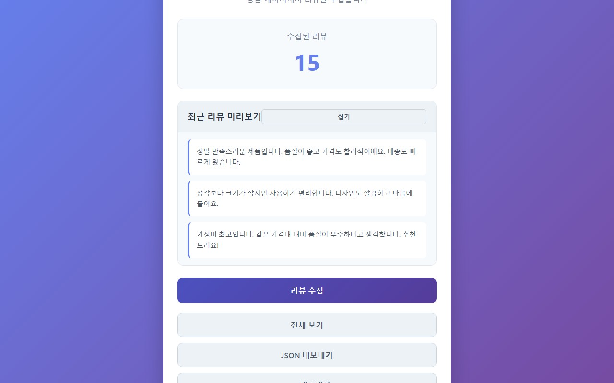

# 쿠팡 리뷰 수집기 (Coupang Review Collector)

쿠팡 상품 페이지에서 고객 리뷰를 자동으로 수집하고 관리할 수 있는 Chrome 확장 프로그램입니다.


## 📋 목차

- [주요 기능](#-주요-기능)
- [스크린샷](#-스크린샷)
- [설치 방법](#-설치-방법)
- [사용 방법](#-사용-방법)
- [기술 스택](#-기술-스택)
- [프로젝트 구조](#-프로젝트-구조)
- [권한 설명](#-권한-설명)
- [개인정보 처리](#-개인정보-처리)
- [개발](#-개발)
- [라이선스](#-라이선스)

## ✨ 주요 기능

### 1. 리뷰 자동 수집

- 쿠팡 상품 페이지에서 리뷰를 자동으로 수집
- 현재 페이지에 표시된 모든 리뷰를 한 번에 수집
- 중복 리뷰 자동 제거

### 2. 실시간 통계

- 수집된 리뷰 개수를 실시간으로 표시
- 팝업을 열 때마다 최신 개수 확인

### 3. 리뷰 미리보기

- 최근 수집된 리뷰 5개를 미리 확인
- 접기/펼치기 기능으로 표시 제어
- 각 리뷰는 3줄까지 미리보기

### 4. 전체 리뷰 보기

- 수집된 모든 리뷰를 모달 창에서 확인
- 리뷰 번호와 함께 순서대로 표시
- 스크롤로 전체 리뷰 탐색

### 5. 데이터 내보내기

- **JSON 내보내기**: 구조화된 JSON 형식으로 내보내기
  - 내보낸 날짜, 총 개수, 리뷰 배열 포함
  - 프로그래밍 및 분석 용도에 적합
- **CSV 내보내기**: 엑셀 등에서 바로 열 수 있는 CSV 형식
  - UTF-8 BOM 포함으로 한글 깨짐 방지
  - 번호와 리뷰 내용으로 구성

### 6. 데이터 관리

- 데이터 삭제: 수집된 모든 리뷰를 한 번에 삭제
- 삭제 전 확인 메시지로 실수 방지

## 📸 스크린샷



## 🚀 설치 방법

### Chrome Web Store에서 설치 (예정)

Chrome Web Store에서 검색하여 설치하세요.

### 개발자 모드로 설치

1. 이 저장소를 클론하거나 ZIP 파일로 다운로드
2. Chrome 브라우저에서 `chrome://extensions/` 접속
3. 우측 상단의 "개발자 모드" 활성화
4. "압축해제된 확장 프로그램을 로드합니다" 클릭
5. 다운로드한 폴더 선택

## 📖 사용 방법

### 1. 리뷰 수집하기

1. 쿠팡 상품 페이지에서 확장 프로그램 아이콘 클릭
2. "리뷰 수집" 버튼 클릭
3. 수집 완료 메시지 확인

### 2. 리뷰 확인하기

- **미리보기**: 팝업에서 최근 리뷰 5개 확인
- **전체 보기**: "전체 보기" 버튼으로 모든 리뷰 확인

### 3. 데이터 내보내기

- **JSON 내보내기**: "JSON 내보내기" 버튼 클릭
- **CSV 내보내기**: "CSV 내보내기" 버튼 클릭
- 다운로드된 파일은 브라우저의 다운로드 폴더에 저장됩니다

### 4. 데이터 삭제

- "데이터 삭제" 버튼 클릭
- 확인 메시지에서 확인 클릭

## 🛠 기술 스택

- **Manifest V3**: 최신 Chrome 확장 프로그램 표준
- **Vanilla JavaScript**: 순수 JavaScript 사용
- **Chrome Storage API**: 로컬 데이터 저장
- **Content Scripts**: 페이지 DOM 접근
- **Chrome Extension APIs**: 확장 프로그램 기능 구현

## 📁 프로젝트 구조

```text
coupang-review-collector/
├── manifest.json          # 확장 프로그램 설정 파일
├── popup.html             # 팝업 UI HTML
├── popup.css              # 팝업 스타일
├── popup.js               # 팝업 로직 및 이벤트 처리
├── content.js             # 페이지에서 리뷰 수집 스크립트
├── analysis.js            # 리뷰 분석 유틸리티 (향후 사용)
├── coupang_logo.png       # 확장 프로그램 아이콘
├── screenshot_1280x800.jpg # 스크린샷
└── README.md              # 프로젝트 문서
```

## 🔐 권한 설명

### storage

- 수집한 리뷰 데이터를 브라우저 로컬 저장소에 저장
- 사용자가 브라우저를 닫아도 데이터 유지

### activeTab

- 현재 활성화된 탭의 URL 확인
- 쿠팡 페이지인지 검증
- 활성 탭의 content script와 메시지 통신

### host_permissions (<https://www.coupang.com/>*)

- 쿠팡 페이지에 content script 주입
- 페이지의 DOM 구조에 접근하여 리뷰 텍스트 추출

## 🔒 개인정보 처리

### 수집하는 정보

- 쿠팡 상품 페이지에 공개된 리뷰 텍스트 내용만 수집

### 수집하지 않는 정보

- 사용자 개인정보 (이름, 이메일, 전화번호 등)
- 리뷰 작성자 정보
- 계정 정보
- 결제 정보

### 데이터 저장

- 모든 데이터는 사용자의 브라우저 로컬 저장소에만 저장
- 외부 서버로 전송하지 않음
- 제3자에게 제공하지 않음

자세한 내용은 개인정보처리방침을 참고하세요.

## 💻 개발

### 개발 환경 설정

1. 저장소 클론

```bash
git clone https://github.com/LordOfWins/coupang_review_collector.git
cd coupang_review-collector
```

1. Chrome 확장 프로그램으로 로드

- `chrome://extensions/` 접속
- 개발자 모드 활성화
- "압축해제된 확장 프로그램을 로드합니다" 클릭
- 프로젝트 폴더 선택

### 코드 수정 후

1. `chrome://extensions/`에서 확장 프로그램 새로고침
2. 변경사항 확인

## 📝 라이선스

이 프로젝트는 MIT 라이선스를 따릅니다.

## 🤝 기여

버그 리포트, 기능 제안, Pull Request를 환영합니다!

## 📧 문의

프로젝트에 대한 문의사항이 있으시면 이슈를 등록해주세요.

---

**주의사항**: 이 확장 프로그램은 쿠팡 웹사이트의 공개 리뷰만 수집하며, 사용자의 개인정보는 수집하지 않습니다. 모든 데이터는 사용자의 브라우저에만 저장됩니다.
